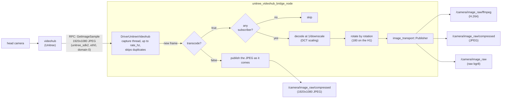

# unitree_videohub_bridge

Publishes the head camera of Unitree robots (G1, H1) on ROS 2, **without stopping Unitree's videohub service**, which
owns the camera. Both robots publish on the same topics (`/camera/image_raw` and its transports). The H1 camera is
mounted upside down, so its images are rotated by 180 degrees.

By default the images are downscaled to 960x540 and compressed with H.264, which needs about **1 Mbit/s** instead of
the ~22 Mbit/s of the original 1920x1080 JPEG frames.

```bash
# On the onboard computer of the robot
ros2 launch unitree_videohub_bridge unitree_videohub_bridge_launch.py robot:=g1   # or robot:=h1

# On any computer on the same ROS network
ros2 run rqt_image_view rqt_image_view   # choose /camera/image_raw/ffmpeg in the list
```

- [Why this package exists](#why-this-package-exists)
- [How it works](#how-it-works)
- [Rotation (H1)](#rotation-h1)
- [How the compression works](#how-the-compression-works)
- [Measurements](#measurements)
- [Install](#install)
- [Parameters](#parameters)
- [Usage](#usage)
- [Troubleshooting](#troubleshooting)
- [Files](#files)

## Why this package exists

The head camera is a video device on the onboard computer (on the G1, the RealSense colour stream is `/dev/video4`).
Unitree's videohub service keeps it open (on the G1, `videohub_pc4`, started by `master_service`, which also runs
locomotion, so it must not be stopped). Opening the device from ROS (e.g. `v4l2_camera`) therefore fails with
`Device or resource busy`.

videohub also serves the frames over Unitree's DDS RPC (service `videohub`, the one the Unitree app uses). This
package requests the frames through that RPC and republishes them on ROS 2. It never touches the video device, so the
Unitree app and other SDK clients keep working. The requests are done by `DriverUnitreeVideohub`, from
[unitree_drivers](https://github.com/Adorno-Lab/unitree_drivers). On the G1: 1920x1080 JPEG frames of ~145 KB, about
16 ms per request, about 18 new frames per second.

## How it works



### 1. Reading the frames from videohub

`DriverUnitreeVideohub` sends the requests of `unitree::robot::go2::VideoClient` (API version `1.0.0.0`, API id
`1001`, an empty binary request, a binary JPEG reply), with a configurable service name. The Unitree DDS (CycloneDDS
bundled with `unitree_sdk2`, domain 0, interface `eth0` on 192.168.123.x) is initialised once in the process with
`ChannelFactory::Init()`. It is separate from the DDS of ROS 2, and the two do not interfere.

The requests block until videohub answers or `rpc_timeout_sec` expires, so they run in the capture thread of the
driver, not in the ROS executor. The driver:

1. requests a frame, at most `rate_hz` times per second (30 by default);
2. **skips duplicates**. videohub answers with its *latest* frame, and the camera delivers about 18 new frames per
   second, so polling at 30 Hz returns the same frame about 40 % of the time. A frame identical to the previous one
   is not published, which also saves its decoding and encoding;
3. calls the node with each new frame, which publishes it (see below).

Every 5 s the node warns about failed requests, with the meaning of the unitree_sdk2 error code (e.g. `3104`:
timeout, nobody answered), and every 10 s it logs the published rate, duplicates, failures, and the mean duration of
the requests and decoding. On Ctrl+C the driver stops; this takes at most one pending request.

### 2. Publishing: the two modes

**`transcode: true` (default).** The JPEG is decoded at a reduced resolution, rotated by `rotation` degrees, and
published as a `sensor_msgs/Image` through an `image_transport::Publisher` on `/camera/image_raw`. Every installed
transport plugin then publishes on its own subtopic:

| Topic | Transport | Content |
|---|---|---|
| `/camera/image_raw/ffmpeg` | `ffmpeg` (ffmpeg_image_transport) | H.264, the least bandwidth |
| `/camera/image_raw/compressed` | `compressed` (compressed_image_transport) | JPEG |
| `/camera/image_raw` | `raw` | uncompressed `bgr8` (1.5 MB per frame at 960x540: for local consumers only) |

A subscriber chooses the transport (e.g. the drop-down of `rqt_image_view`, or the transport argument of
`image_transport::create_subscription`) and receives a decoded `sensor_msgs/Image` either way.

The work depends on what is being watched:
- `image_transport::Publisher::publish()` calls only the plugins whose topic has subscribers, so a format that
  nobody watches is never encoded;
- when no transport has subscribers, the node does not even decode the JPEG. With nobody watching, the bridge only
  polls videohub.

**`transcode: false`.** The JPEG of videohub is published as it comes, as `sensor_msgs/CompressedImage` with
`format: jpeg`, on `/camera/image_raw/compressed`: the topic of the `compressed` plugin, so subscribers use the
`compressed` transport. Full resolution and no work on the robot, but ~145 KB per frame (~22 Mbit/s). The frames are
not decoded, so they cannot be rotated: the node refuses to start with `transcode: false` and a `rotation` other than
0 (e.g. on the H1).

### 3. QoS

The publishers use the sensor-data profile (keep last 5, volatile), but **reliable**. A reliable publisher matches
both kinds of subscriber:
- best-effort ones (e.g. `rmw_qos_profile_sensor_data`), which then receive best effort, without retransmissions;
- reliable ones, the default of `image_transport` (`rqt_image_view`, `image_transport republish`). These receive
  nothing from a best-effort publisher.

## Rotation (H1)

The H1 head camera is mounted upside down, so `config/h1.yaml` sets `rotation: 180`. This is a rotation, not a vertical
flip: a vertical flip alone would also mirror the image left to right. `rotation` takes 0, 90, 180, or 270 (clockwise,
in degrees); 90 and 270 swap the width and the height.

The image is rotated after the reduced-resolution decoding, so it costs little (well under 1 ms at 960x540), and
written straight into the message, without an extra copy. Since the published image is upright, its `frame_id` must
name the optical frame of the rotated image: the physical optical frame of the camera, rotated by 180 degrees about
its z axis.

## How the compression works

The camera produces 1920x1080 colour images: 6.2 MB per frame uncompressed, about 900 Mbit/s at 18 Hz. Three steps
bring that down to about 1 Mbit/s.

### Step 1: videohub's JPEG (on the robot, before the bridge)

videohub already compresses every frame to JPEG (~145 KB, about 43:1). JPEG splits the image into 8x8-pixel
blocks, transforms each block with the discrete cosine transform (DCT) into 64 frequency coefficients, quantises them
(discards the fine detail the eye barely sees), and entropy-codes the result (Huffman). Every frame is independent.

### Step 2: decoding at a reduced resolution (DCT scaling)

To downscale, the bridge does **not** decode the full 1920x1080 image and then resize it. It calls `cv::imdecode`
with `IMREAD_REDUCED_COLOR_2` (or `_4`, `_8`), which makes libjpeg decode directly at 1/2 (1/4, 1/8) of the
resolution. Each 8x8 block of DCT coefficients is turned back into 4x4 (2x2, 1x1) pixels by an inverse DCT of reduced
size, using only its low-frequency coefficients. The entropy decoding still reads the whole file, but the inverse
DCT, the colour conversion, and the memory traffic shrink with the output size: 4x fewer pixels at 1/2, 16x fewer at
1/4. The time of each decoding is in the statistics of the log (`mean decoding`).

The result is cropped to even width and height (a view, no copy), because H.264 in 4:2:0 colour needs them
(1080/8 = 135 rows becomes 134).

### Step 3a: H.264 (transport `ffmpeg`)

JPEG compresses each image on its own. **H.264 also removes what does not change between consecutive images**, and
that is where most of the saving comes from. The encoder (libx264 through ffmpeg_image_transport) produces two kinds
of frames:

- **I-frames (keyframes)**: compressed on their own, like a JPEG (but better: intra prediction from neighbouring
  blocks, an integer transform, and adaptive entropy coding);
- **P-frames**: for each 16x16 block, the encoder searches the previous frame for the most similar block (*motion
  estimation*) and sends only a motion vector plus the small difference (the *residual*). When the head is still,
  most blocks are "same as before, no residual", which costs almost nothing. When it moves, blocks are mostly
  "shifted by a few pixels".

The settings in [`config/unitree_videohub_bridge.yaml`](config/unitree_videohub_bridge.yaml)
(`camera.image_raw.ffmpeg.*`):

| Setting | Value | Meaning |
|---|---|---|
| `encoder` | `libx264` | software H.264 encoder (it runs on the CPU of the onboard computer) |
| `preset:ultrafast` | in `encoder_av_options` | the fastest motion search and coding tools: the least CPU, at the cost of some compression |
| `tune:zerolatency` | in `encoder_av_options` | no lookahead and no frame buffering: each image is encoded and published as soon as it arrives |
| `crf:28` | in `encoder_av_options` | *constant rate factor*: constant visual quality, so the bitrate follows the content (small for a still scene, bigger in motion). Lower is better and bigger: 23 is the x264 default, ~6 steps double or halve the size |
| `gop_size` | `18` | one keyframe every 18 frames (~1 s at 18 Hz); see the trade-off below |
| `max_b_frames` | `0` | no B-frames (frames predicted from *future* frames too): they would delay every image by at least one frame |

**The keyframe interval (`gop_size`) trade-off.** A P-frame can only be decoded if the frames it refers to arrived.
So a subscriber that joins must wait for the next keyframe before it shows anything. Likewise, if a frame is lost
(e.g. a best-effort subscriber on Wi-Fi), the picture is corrupted or frozen until the next keyframe. Keyframes are
much bigger than P-frames, so frequent keyframes cost bandwidth:

| `gop_size` | Recovery after a loss / join | Bandwidth (960x540, crf 28) |
|---|---|---|
| 5 | ≤ 0.3 s | 1.27 Mbit/s |
| 18 (default) | ≤ 1 s | 0.83 Mbit/s |

**Why CRF and not a fixed bitrate.** With libx264, `bit_rate: 1000000` (1 Mbit/s) produced 0.21 Mbit/s with poor
quality: the encoder did not hold the target. CRF gives a predictable quality instead. If the bandwidth must be
capped, lower the resolution (`downscale`) or raise `crf`.

The message on the wire is `ffmpeg_image_transport_msgs/FFMPEGPacket` (the encoded bytes plus size, keyframe flag,
and timestamp). The subscriber's plugin decodes it with ffmpeg back into a `sensor_msgs/Image`.

### Step 3b: JPEG (transport `compressed`)

The `compressed` plugin re-encodes each downscaled image as a JPEG of quality 60
(`camera.image_raw.compressed.jpeg_quality`; the plugin default, 95, is wasteful). Every frame stands alone, so a lost
frame does not affect the next ones and a subscriber sees an image immediately. The price is about 6x the bandwidth
of H.264. Use it if the H.264 stream shows artifacts on a lossy link.

## Measurements

Measured on a desktop computer with a fake videohub (built with the server API of `unitree_sdk2`): a panning 1080p
scene of JPEG frames of ~145 KB, 18 new frames per second, as measured on the G1. Bandwidth is that of the serialized
messages; CPU is that of the bridge process (decoding plus encoding), on the desktop.

| Configuration | Per frame | Bandwidth | Bridge CPU |
|---|---|---|---|
| passthrough 1920x1080 JPEG (`transcode: false`) | 146 KB | 21.7 Mbit/s | 1 % |
| 960x540 JPEG q80 | 50 KB | 7.4 Mbit/s | 11 % |
| 960x540 JPEG q60 (`compressed`, default) | 35 KB | 5.3 Mbit/s | 11 % |
| 960x540 H.264 crf 23 | 10 KB | 1.5 Mbit/s | 17 % |
| **960x540 H.264 crf 28 (`ffmpeg`, default)** | **5.6 KB** | **0.8 Mbit/s** | **17 %** |
| 480x270 JPEG q60 | 14 KB | 2.1 Mbit/s | 6 % |
| 480x270 H.264 crf 28 (`downscale: 4`) | 2.3 KB | 0.35 Mbit/s | 8 % |

All configurations delivered the full ~18 Hz, after decoding too.

Caveats:
- **The test scene is a flat illustration**, which compresses unusually well. The real camera, with texture and
  sensor noise, needs more bandwidth for every option; the ranking holds. Measure on the robot with
  `ros2 topic bw /camera/image_raw/ffmpeg`.
- **CPU was measured on the desktop.** The ARM cores of the onboard computer are slower: expect several times these
  values (a rough estimate). If it is too much, use `downscale: 4`.

## Install

Dependencies that are not ROS packages, installed first:
- [unitree_sdk2](https://github.com/unitreerobotics/unitree_sdk2) (found in the default paths or in
  `/opt/unitree_robotics`);
- [unitree_drivers](https://github.com/Adorno-Lab/unitree_drivers), with `DriverUnitreeVideohub` (see its README).

ROS dependencies: `rclcpp`, `sensor_msgs`, `image_transport`, OpenCV (`imgcodecs`), and, at run time,
`ffmpeg_image_transport` and `compressed_image_transport` (e.g. `sudo apt install ros-jazzy-ffmpeg-image-transport
ros-jazzy-compressed-image-transport`). Without them only the `raw` transport is available.

```bash
cd ~/ros2_ws/src
git clone https://github.com/Adorno-Lab/unitree_videohub_bridge.git
cd ~/ros2_ws
colcon build --packages-select unitree_videohub_bridge
```

## Parameters

Set in [`config/unitree_videohub_bridge.yaml`](config/unitree_videohub_bridge.yaml) (shared by the robots) and
`config/<robot>.yaml` (loaded after it, so it takes precedence). `domain_id`, `network_interface`, `transcode`, and
`downscale` are also launch arguments, which take precedence over both files.

| Parameter | Default | Description |
|---|---|---|
| `domain_id` | `0` | DDS domain of the Unitree network (0 on the robot) |
| `network_interface` | `eth0` | interface on the Unitree network (192.168.123.x) |
| `service_name` | `videohub` | name of the videohub RPC service |
| `rate_hz` | `30.0` | maximum rate of the requests to videohub |
| `rpc_timeout_sec` | `1.0` | timeout of each request |
| `frame_id` | `head_camera_color_optical_frame` | `frame_id` of the published images |
| `topic` | `/camera/image_raw` | base topic of the images |
| `skip_duplicates` | `true` | do not publish a frame identical to the previous one |
| `transcode` | `true` | decode, downscale, rotate, and publish through image_transport; `false`: the JPEG of videohub as it comes |
| `downscale` | `2` | 1, 2, 4, or 8: 1920x1080 → 1920x1080, 960x540, 480x270, 240x134 |
| `rotation` | `0` (G1), `180` (H1) | 0, 90, 180, or 270: clockwise rotation of the image, in degrees (needs `transcode: true` unless 0) |
| `camera.image_raw.ffmpeg.*` | see the YAML | H.264 encoder settings (see [Step 3a](#step-3a-h264-transport-ffmpeg)) |
| `camera.image_raw.compressed.jpeg_quality` | `60` | JPEG quality of the `compressed` transport |

The names of the transport parameters follow the topic: `/camera/image_raw` → `camera.image_raw.<transport>.*`. If
`topic` is changed, rename them in the YAML too.

## Usage

The bridge runs on the onboard computer of the robot, on the host network (e.g. a Docker container with
`--net=host`). It needs no access to the video devices.

```bash
ros2 launch unitree_videohub_bridge unitree_videohub_bridge_launch.py robot:=g1
ros2 launch unitree_videohub_bridge unitree_videohub_bridge_launch.py robot:=h1                    # rotated by 180 degrees
ros2 launch unitree_videohub_bridge unitree_videohub_bridge_launch.py robot:=g1 downscale:=4       # 480x270, about half the bandwidth
ros2 launch unitree_videohub_bridge unitree_videohub_bridge_launch.py robot:=g1 transcode:=false   # 1920x1080 JPEG as it comes (G1 only)
ros2 launch unitree_videohub_bridge unitree_videohub_bridge_launch.py robot:=g1 config_file:=<file>  # other shared settings
```

Viewers (same `ROS_DOMAIN_ID` as the bridge):

```bash
ros2 run rqt_image_view rqt_image_view   # choose the transport in the list
```

Checks:

```bash
ros2 topic hz /camera/image_raw/ffmpeg   # ~18 Hz while subscribed
ros2 topic bw /camera/image_raw/ffmpeg   # the real bandwidth
```

The log shows the statistics every 10 s. For example, with the fake videohub and nobody watching (on the G1, a
request takes ~16 ms):

```
::Last 10.0001 s: published 0 frames (0 Hz), 197 duplicates skipped, 0 failed requests, mean request 11.98 ms,
95 not decoded (no subscribers), mean decoding 0 ms.
```

## Troubleshooting

| Symptom | Cause / fix |
|---|---|
| `requests to videohub failed ... code 3104` | Nobody answered: wrong `network_interface` (check `ip a` for 192.168.123.x), `domain_id`, or `service_name`. |
| `published 0 frames`, `N not decoded (no subscribers)` | Normal while nobody watches: nothing is decoded or encoded. |
| `rotation is 180, but without transcode ...` at startup | `transcode:=false` on the H1: its frames must be decoded to be rotated. |
| `error while loading shared libraries: libunitree_drivers_videohub.so.0` | unitree_drivers was installed but the linker cache was not updated: `sudo ldconfig`. |
| A reliable subscriber receives nothing | Check that the publisher is reliable (the default). |
| `failed to create context for HW device: cuda` / `h264_cuvid` errors on the viewer | The H.264 decoder tries the NVIDIA hardware decoder first, then falls back to software. Harmless. |
| Smearing or freezing for up to 1 s on Wi-Fi | Lost H.264 frames; the picture recovers at the next keyframe. Lower `gop_size`, or use the `compressed` transport. |
| Image timestamps far off | The clock of the onboard computer is not synchronised; the images are stamped on reception. |

## Files

| File | Content |
|---|---|
| [`src/UnitreeVideohubBridge.h`](src/UnitreeVideohubBridge.h), [`.cpp`](src/UnitreeVideohubBridge.cpp) | the node: reduced decoding, rotation, publishing, statistics |
| [`src/unitree_videohub_bridge_node.cpp`](src/unitree_videohub_bridge_node.cpp) | `main()` |
| [`config/unitree_videohub_bridge.yaml`](config/unitree_videohub_bridge.yaml) | parameters shared by the robots, including the H.264 and JPEG settings |
| [`config/g1.yaml`](config/g1.yaml), [`config/h1.yaml`](config/h1.yaml) | parameters of each robot (rotation) |
| [`launch/unitree_videohub_bridge_launch.py`](launch/unitree_videohub_bridge_launch.py) | launch file (`robot:=g1` or `robot:=h1`) |
